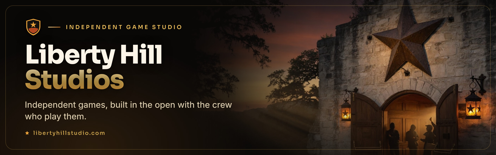

Liberty Hill Studios is an independent game studio in the Texas Hill Country, building its games in
the open with a crew of testers, artists and players who ship alongside us.

## Open source

<table>
<tr>
<td width="96" valign="top"></td>
<td valign="top">
<b><a href="https://github.com/LibertyHillStudios/reliquary">Reliquary</a></b> 
An addon for WoW: Forever that keeps a record of every character you play, and shares it with your
guild, friends or anyone, as each character chooses. 
<a href="https://www.curseforge.com/wow/addons/reliquary-character-chronicle">CurseForge</a> · <a href="https://reliquary.libertyhillstudio.com/">A character's page</a> · Apache 2.0
</td>
</tr>
</table>

## Find us

- **Website:** [libertyhillstudio.com](https://libertyhillstudio.com)
- **Work with us:** [libertyhillstudio.com/build](https://libertyhillstudio.com/build)
- **Email:** [support@libertyhillstudio.com](mailto:support@libertyhillstudio.com)
